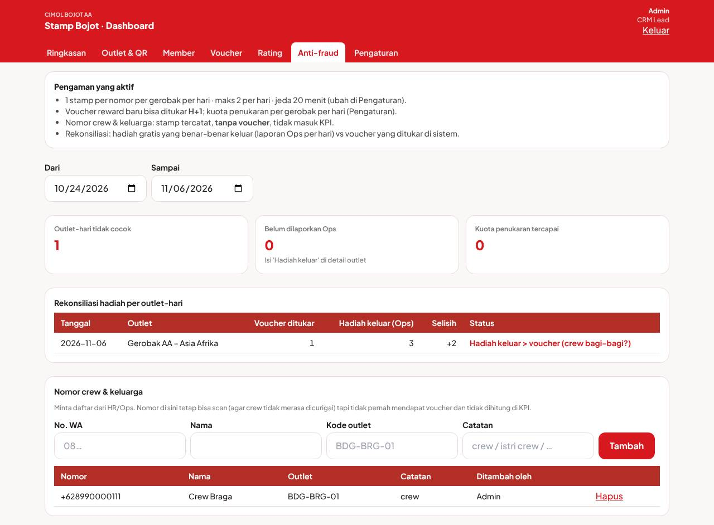
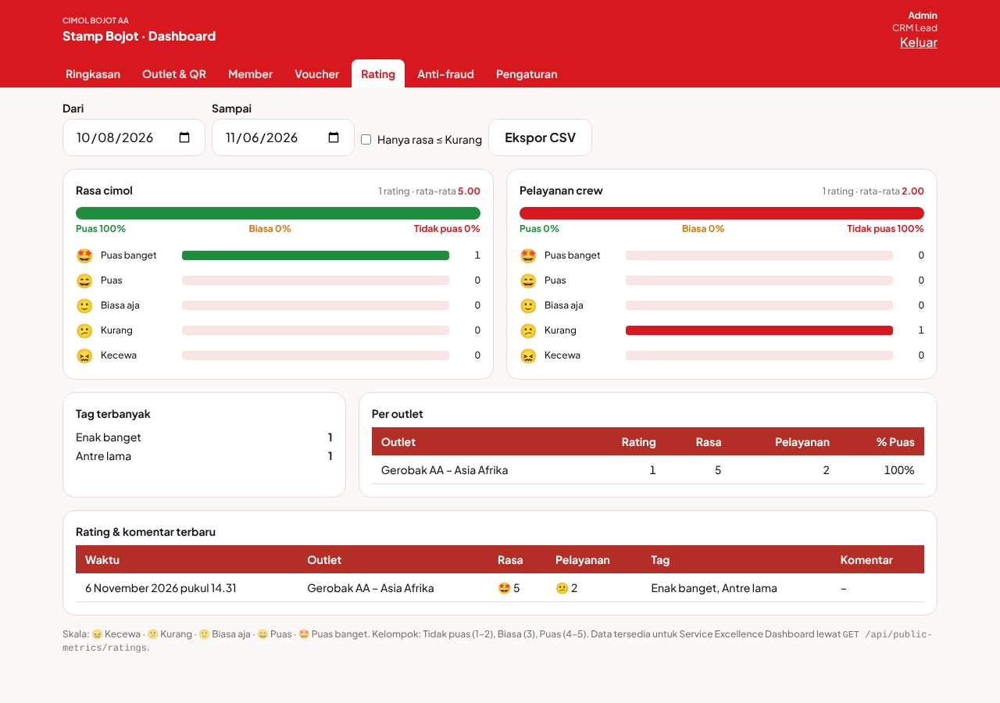
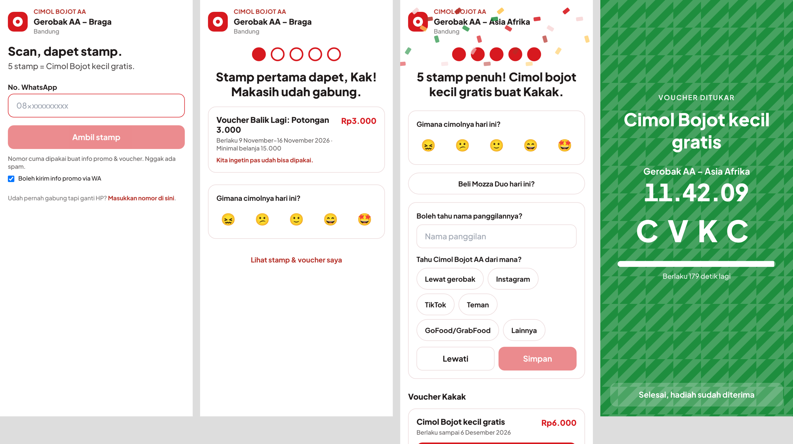
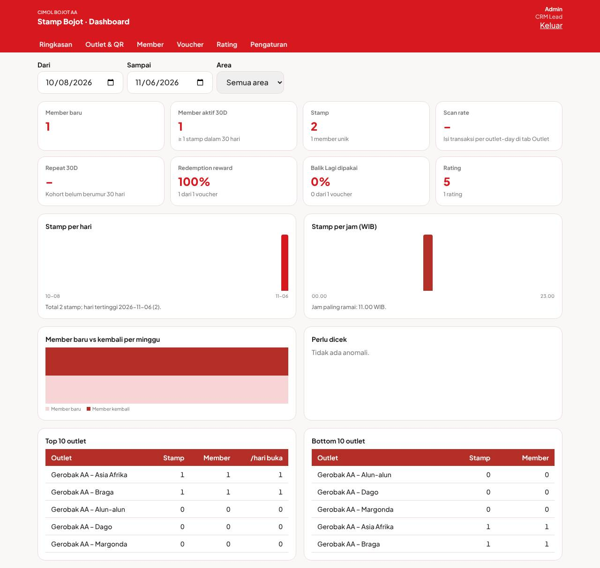

# CRMGerobak — "Stamp Bojot"

CRM & loyalty berbasis QR untuk gerobak **Cimol Bojot AA** (CRK Group). Customer scan stiker QR di gerobak → dapat stamp; 5 stamp = Cimol Bojot kecil gratis. Crew tidak memegang perangkat apa pun.

Spec lengkap: dokumen project *CRK Gerobak CRM — Build Spec* (bagian PROMPT UTAMA & Prinsip desain).

## Prinsip
| | |
|---|---|
| **Customer ≤ 15 detik** | Tanpa install, tanpa OTP, tanpa password. Member lama: scan → stamp masuk tanpa tap. Member baru: 1 field nomor WA. Bundle halaman customer ±66 KB gzip. |
| **Crew nol perangkat** | Hanya mengenali **layar hijau** penukaran (nama gerobak, jam berjalan, kode 4 huruf, hitung mundur 3 menit) dan menyerahkan hadiah. |
| **Anti-abuse di server** | 1 stamp/nomor/gerobak/hari · maks 2/hari · jeda 20 menit · geofence hanya *flag* · idempoten per `requestId` · rate limit IP & nomor · QR per gerobak bisa diganti. |
| **Data untuk marketing** | Visit per gerobak per jam, repeat 30D, rating 1-tap per outlet, "tahu dari mana", kode promo aktif (mis. `MOZZA-DUO`). |

## Struktur
```
backend/   FastAPI + Motor (MongoDB) + APScheduler  → app/services/stamp.py adalah inti aturan
frontend/  React + Vite + Tailwind → build ke backend/static (disajikan FastAPI)
Dockerfile, docker-compose.yml, .env.example, .github/workflows/ci.yml
```

## Jalankan cepat (tanpa MongoDB, data in-memory)
```bash
cd frontend && npm ci && npm run build && cd ..
cd backend && pip install -r requirements.txt
USE_MOCK_DB=true PUBLIC_BASE_URL=http://localhost:8000 uvicorn app.main:app --port 8000
```
Buka `http://localhost:8000/admin` → login **Admin / 1234** → Pengaturan → **Isi outlet contoh** → tab Outlet & QR → buka *Stiker A6* atau klik baris outlet untuk melihat URL `/s/{token}` dan coba di HP.

## Checklist go-live pilot (Railway)
1. **Database permanen**: di project Railway klik **+ New → Database → MongoDB**. Buka service MongoDB → tab Variables → salin `MONGO_URL` (atau `MONGO_PUBLIC_URL`). Di service app: set `MONGO_URL` = nilai itu, ubah `USE_MOCK_DB` = `false`. Cek log: harus ada "MongoDB terhubung".
2. **Rahasia**: `DEFAULT_ADMIN_PIN` (4–6 angka, dipakai saat admin pertama dibuat — kalau admin sudah ada, ganti PIN lewat Pengaturan → Admin), `METRICS_API_KEY` (acak panjang), `SECRET_KEY`.
3. `PUBLIC_BASE_URL` = `https://…up.railway.app` (atau domain sendiri; QR stiker dicetak dari nilai ini — jangan diganti setelah stiker dicetak).
4. Pengaturan di dashboard: kembalikan **Jeda minimal = 20**, **Maks. stamp/hari = 2** bila sempat diubah untuk uji; isi **Email digest** dan SMTP bila ingin email harian.
5. Buat admin per role (Manager, CRM Lead, Area Bandung, Viewer) dan **nonaktifkan/ganti PIN akun Admin bawaan**.
6. Impor outlet pilot (CSV dengan koordinat) → unduh stiker A6 + tent card → cetak → tempel di sisi gerobak dekat QRIS (bukan di meja goreng).
7. Masukkan nomor crew & keluarga (tab Anti-fraud). Briefing crew satu kalimat + cara mengenali layar hijau (ada di tent card).
8. **Lupa PIN Manager (akun Admin)?** Set variabel `RESET_ADMIN_PIN=true` dan `DEFAULT_ADMIN_PIN=<pin baru>` → tunggu deploy ulang → login `Admin` → **hapus** `RESET_ADMIN_PIN`. Variabel `DEFAULT_ADMIN_PIN` sendiri hanya dipakai saat akun pertama dibuat.
9. Backup: jalankan **Backup sekarang** mingguan dan unduh — disk Railway tidak permanen; atau aktifkan backup otomatis di MongoDB Atlas.

## Jalankan produksi
```bash
cp .env.example .env   # isi PUBLIC_BASE_URL, SECRET_KEY, DEFAULT_ADMIN_PIN, METRICS_API_KEY, SMTP (opsional)
docker compose up -d --build
```
App di port 8000 (taruh di belakang Caddy/Nginx dengan HTTPS — kamera HP hanya membuka QR ke URL https). MongoDB Atlas juga bisa: isi `MONGO_URL`, hapus service `mongo`.

Dev terpisah: `uvicorn app.main:app --reload` (port 8000) + `cd frontend && npm run dev` (port 5173, proxy `/api`).

## Alur customer
1. `/s/{qrToken}` — perangkat dikenal → `POST /api/stamp` langsung; belum dikenal → form nomor WA.
2. Hasil: dots progres, headline, **rating wajib dua tahap** (emoji 😖 Kecewa · 😕 Kurang · 🙂 Biasa aja · 😄 Puas · 🤩 Puas banget; kelompok Tidak puas/Biasa/Puas; tag mengikuti emoji; tulis sendiri bila ≤ Kurang): **pelayanan crew** dinilai saat scan (baru beli), **rasa cimol** dinilai setelah dimakan — ditanya di kunjungan berikutnya ("Cimol dari Gerobak Braga kemarin, rasanya gimana?") atau di `/saya`. Voucher baru bisa ditukar setelah pelayanan hari ini + rasa kunjungan lalu terisi (`feedbackRequired`). Lalu chip promo aktif, pertanyaan profil (kunjungan ke-2, maks. 2× lewati), voucher.
3. Stamp ke-5 → voucher `stamp_reward` (30 hari). Member baru → voucher **Balik Lagi** aktif H+3 selama 7 hari.
4. **Tukar sekarang** hanya jika sudah scan gerobak dalam 60 menit terakhir → layar hijau + kode 4 huruf + hitung mundur.
5. `/saya` — progres, voucher, riwayat, opt-out WA, pindah HP (ketik nomor; OTP = Iterasi 1).

## Admin (`/admin`, login nama + PIN; 5× salah → kunci 15 menit)
Role **Manager** (akses penuh: termasuk kelola akun admin, job, data contoh), **CRM Lead** (operasional: pengaturan program, member, nomor crew, campaign, ekspor), **Area** (hanya area yang ditugaskan, nomor dimasker), **Viewer** (baca, nomor dimasker). Akun bawaan `Admin` = Manager.
Ringkasan (member baru, aktif 30D, stamp, scan rate, repeat 30D, redemption, Balik Lagi, rating, grafik per hari/jam/minggu, top/bottom outlet, perlu dicek, lonjakan) · Outlet & QR (CRUD, impor CSV, heatmap hari×jam, transaksi POS manual, stiker A6/tent card PDF, ZIP per area, **Ganti QR**) · Member (cari, detail, ±stamp, voucher manual, blokir, hapus/anonimkan — semua dengan alasan → audit log) · Voucher (statistik, campaign per segmen) · Rating · Pengaturan (program, anti-abuse, Balik Lagi, promo aktif, admin, job, audit).

## Anti-fraud crew (lapis 1 + 3)
- **Batasi kerugian**: aturan stamp di atas + voucher reward baru bisa ditukar **H+1** (`rewardRedeemAfterDays`) + kuota penukaran per gerobak per hari (`maxRedemptionsPerOutletPerDay`, lebih → ditolak ramah + alert).
- **Hilangkan motif**: daftar **nomor crew & keluarga** (tab Anti-fraud) — tetap bisa scan, tanpa voucher, tidak masuk KPI; jangan beri insentif crew per stamp/member.
- **Rekonsiliasi**: Ops mengisi "hadiah gratis keluar" per outlet-hari (detail outlet) → dibandingkan dengan voucher yang ditukar; selisih dua arah tampil di tab Anti-fraud.
- Lapis 2 (deteksi pola: 1 HP banyak nomor, 1 IP banyak nomor, stamp di luar jam buka, member "setia 1 gerobak") dan stamp terikat transaksi QRIS/POS: roadmap.




## API ringkas
Publik: `GET /api/outlet/{token}` · `POST /api/stamp` · `POST /api/feedback` · `POST /api/profile` · `POST /api/voucher/{id}/redeem` · `GET /api/me` · `POST /api/me/opt-out` · `POST /api/me/switch-device` (header `X-Device-Token`).
Admin: `/api/admin/*` (Bearer token). Integrasi (header `X-Api-Key`): `GET /api/public-metrics/ratings|crm|promo|summary` — `crm` memberi `member` & `loyalty` untuk KPI CRM Lead di CRK Daily Tracker.

## Job terjadwal (WIB)
00.05 expiry voucher · 10.00 aktivasi voucher (dicek ulang tiap 15 menit) · 21.30 digest harian (email) · Senin 08.30 rekap mingguan · Minggu 02.00 backup JSON (simpan 8). Semua bisa dijalankan manual dari Pengaturan.

## Tes
```bash
cd backend && python -m pytest -q     # 24 skenario acceptance (mongomock, tanpa server Mongo)
```

## Roadmap (Iterasi di build spec)
1. WhatsApp via Fonnte: OTP pindah HP, notif voucher aktif, pengingat H-2 kedaluwarsa, broadcast ≤ 2/bulan.
2. Impor transaksi POS per outlet-day → scan rate otomatis.
3. Atribusi promo (`/api/public-metrics/promo` sudah ada).
4. Referral · 5. PWA · 6. Tier Bojot Lover / Kasta Tertinggi · 7. Adapter Postgres.

## Tampilan


